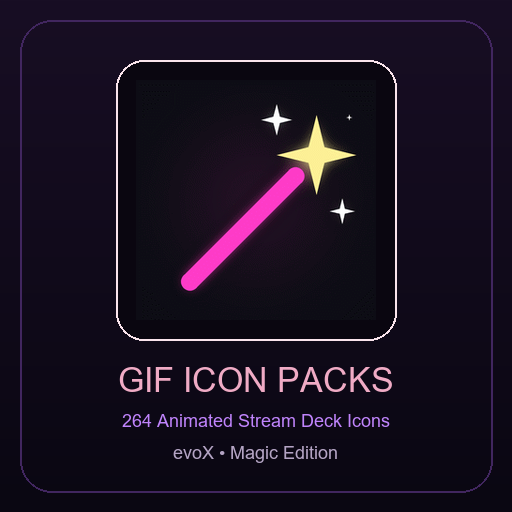

  
  <h1>Gif Icon Packs (226 İkon)</h1>
  
<strong>Elgato Stream Deck & evoX İçin Özel Animasyonlu GIF İkon Koleksiyonu (Sihirli Değnek, Xenon Renkleri, Siber Arayüzler).</strong>

  

    <strong>Dil / Language:</strong> <a href="README.md"><strong>English</strong></a> | <a href="README.tr.md"><strong>Türkçe</strong></a>
    &nbsp;•&nbsp;
    <a href="https://github.com/Hfatih/gif-icon-packs/releases/latest">.evoxpack İndir</a> ·
    <a href="https://hfatih.github.io/gif-icon-packs/">Canlı İnteraktif Galeri</a> ·
    <a href="#kurulum--kullanım">Nasıl Kurulur?</a>
  

  

    
    
    
    
    
  

---

## 🕹️ Canlı Simülatör & Vitrin
226 animasyonlu GIF ikonun tamamını 15 tuşlu sanal Stream Deck donanım simülatörü üzerinde canlı olarak test edin:  
👉 **[Canlı Simülatörü Aç (GitHub Pages)](https://hfatih.github.io/gif-icon-packs/)**

---

## 📖 Genel Bakış
**Gif Icon Packs**, 226 adet seçilmiş animasyonlu GIF ikondan oluşur. Paketin öne çıkan özellikleri arasında özel sihirli değnek (Magic Wand) animasyonu, Xenon-027 kromatik renk çeşitleri (Yeşil, Altın, Mavi, Kırmızı, Mor) ve ses ekolayzerları yer alır.

---

## 📄 Lisans
[MIT Lisansı](LICENSE) altında sunulmaktadır.
